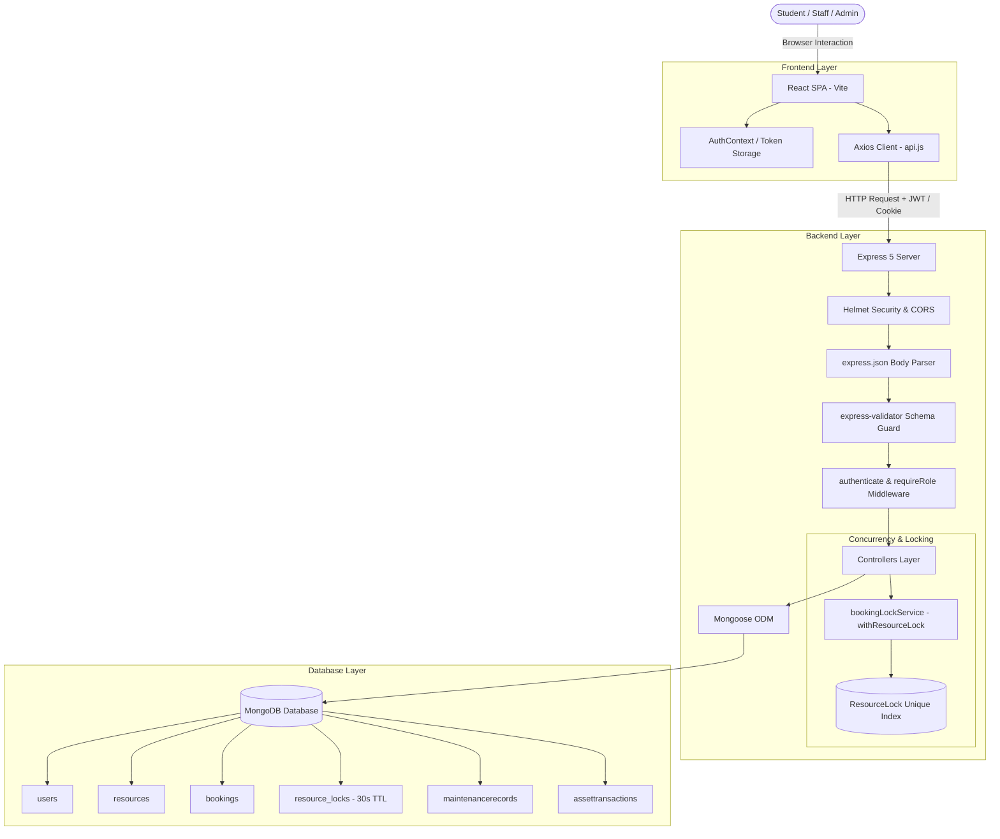

# ResourceFlow

> **Full-Stack College Resource & Asset Management Platform**  
> Engineered with Node.js, Express.js, MongoDB (Mongoose ODM), React (Vite SPA), and an atomic mutex concurrency reservation engine.

[](https://github.com/praneelp23/ResourceFlow)
[](https://nodejs.org/)
[](https://expressjs.com/)
[](https://www.mongodb.com/)
[](https://react.dev/)
[](https://vitejs.dev/)
[](LICENSE)

---

## Table of Contents

1. [Project Overview](#project-overview)
2. [Key Capabilities & Features](#key-capabilities--features)
3. [Technology Stack](#technology-stack)
4. [System Architecture & Data Flow](#system-architecture--data-flow)
5. [Directory & Project Structure](#directory--project-structure)
6. [Booking Concurrency & Mutex Locking Engine](#booking-concurrency--mutex-locking-engine)
7. [Database Models & Schema Design](#database-models--schema-design)
8. [API Endpoint Reference](#api-endpoint-reference)
9. [Local Setup & Teammate Installation Guide](#local-setup--teammate-installation-guide)
10. [Pre-Seeded Demo Credentials](#pre-seeded-demo-credentials)
11. [Environment Variables Specification](#environment-variables-specification)
12. [Automated Testing Suite](#automated-testing-suite)
13. [Security Architecture & Hardening](#security-architecture--hardening)
14. [Contributing & Teammate Workflow](#contributing--teammate-workflow)

---

## Project Overview

**ResourceFlow** is an institutional web platform designed for universities and colleges to streamline the reservation, checkout custody, and maintenance lifecycle of campus facilities and equipment. 

It handles:
- **Campus Facilities**: Computing labs, AI compute clusters, clean rooms, robotics workshops, collaborative sprint rooms, sports courts, and conference suites.
- **Project Assets & Gear**: Cameras, sensors, measurement equipment, development kits, and laboratory kits.
- **Conflict-Free Reservation Engine**: High-concurrency protection using distributed atomic mutex locks to mathematically prevent double-booking race conditions.
- **Three-Tier Role-Based Access Control (RBAC)**: Distinct permissions and purpose-built dashboards for Students, Facility Managers, and System Administrators.
- **Minimalist Institutional Design**: Clean slate-and-white enterprise dashboard layout featuring deep maroon institutional branding, custom SVG iconography, and zero visual clutter.

---

## Key Capabilities & Features

### 1. Student Experience
- **Resource Discovery**: Browse campus resources with live keyword filtering across title, department wing, specifications, and category (`laboratory`, `meeting_room`, `sports_facility`, `equipment`).
- **Real-Time Interval Availability**: Test any start and end datetime window against active reservations and scheduled maintenance before booking.
- **Conflict-Free Booking Submission**: Instant reservation or manager-approval routing based on resource sensitivity, backed by client-side idempotency keys.
- **Reservation Self-Service**: Live listing of upcoming, completed, and pending bookings with one-click rescheduling or cancellation with reason tracking.
- **Student Profile Management**: Manage contact information, academic year, and department with immutable student ID safeguards.

### 2. Facility Operations Desk (Manager Hub)
- **Pending Approvals Queue**: Review restricted facility reservation requests, inspect student purposes, and approve or reject with custom feedback.
- **Equipment Handover & Check-Out**: Record physical gear handovers with initial condition ratings (`excellent`, `good`, `fair`, `damaged`).
- **Return & Custody Closeout**: Verify returned asset condition, record timestamped audit trails, and free resources for subsequent reservations.
- **Maintenance Windows**: Schedule downtime blocks that automatically lock out student bookings for repairs, calibrations, or upgrades.

### 3. Administrator Suite (Master Admin Portal)
- **User Directory**: Search, paginate, and filter accounts by department, academic year, status, or role.
- **Role Elevation**: Assign and manage role privileges (`student` ◄► `manager` ◄► `admin`).
- **Account Safeguards**: Deactivate or reactivate user accounts with built-in protection preventing the demotion or lockout of the last active administrator.
- **Catalog Management**: Add, update, or soft-archive campus assets and facilities without breaking historical reservation records.
- **Utilization Analytics**: Real-time charts demonstrating reservations by category, top-utilized campus facilities, and reservation status breakdowns.

---

## Technology Stack

### Frontend Architecture
| Technology | Version | Purpose |
|---|---|---|
| **React** | `^18.3.1` | Component-driven Single Page Application (SPA) |
| **Vite** | `^5.4.10` | High-speed frontend build tool and dev server with HMR |
| **React Router** | `^6.30.6` | Client-side routing, protected routes, and role guards |
| **Axios** | `^1.20.0` | HTTP client with automatic Bearer token interceptor and centralized error normalization |
| **Recharts** | `^3.10.1` | Declarative SVG charting library for administrator utilization metrics |
| **Inter Font & Custom CSS** | Modern | Minimalist institutional UI system (clean slate background, white surfaces, deep maroon accents `#7a0c2e`, responsive layout) |

### Backend Architecture
| Technology | Version | Purpose |
|---|---|---|
| **Node.js** | `v20+` / `v24 LTS` | Asynchronous JavaScript runtime environment |
| **Express.js** | `^5.3.0` | Fast, unopinionated REST API framework |
| **Mongoose** | `^9.11.4` | Object Data Modeling (ODM) for MongoDB with schema validation and population |
| **JSON Web Tokens (JWT)** | `^9.0.3` | Dual-token authentication (short-lived access tokens + refresh tokens) |
| **Bcrypt.js** | `^3.0.3` | Salted password hashing (12 rounds production, 10 rounds dev) |
| **Helmet** | `^8.3.0` | Security headers (CSP, frameguard, XSS protection, cross-origin resource policy) |
| **CORS** | `^2.8.6` | Cross-Origin Resource Sharing with origin whitelisting and credentials support |
| **Express-Validator** | `^7.3.2` | Declarative request payload sanitization and schema validation |
| **Cookie-Parser** | `^1.4.7` | Secure parsing of HttpOnly session cookies |
| **Morgan** | `^1.12.1` | HTTP request logging |

### Database & Testing
| Technology | Version | Purpose |
|---|---|---|
| **MongoDB** | `v6+` / `v7+` | Document database for persistent storage (Atlas or Local) |
| **MongoMemoryServer** | `^11.3.0` | Embedded zero-config in-memory MongoDB server for testing and automatic local dev fallback |
| **Node.js Test Runner** | Built-in | Native test runner (`node --test`) for fast, zero-dependency unit and integration testing |
| **Supertest** | `^7.3.1` | Programmatic HTTP assertion library for API testing |

---

## System Architecture & Data Flow



---

## Directory & Project Structure

```
ResourceFlow/
├── backend/
│   ├── package.json               # Backend dependencies & npm scripts
│   ├── .env.example               # Template environment configuration
│   ├── scripts/
│   │   ├── devServer.js           # Auto-fallback dev server (embedded DB + seeder)
│   │   └── seed.js                # Database seeder (users, resources, bookings)
│   ├── src/
│   │   ├── app.js                 # Express application configuration & middlewares
│   │   ├── server.js              # Server entrypoint with database connection
│   │   ├── config/
│   │   │   └── database.js        # Mongoose connection pooling & graceful shutdown
│   │   ├── controllers/
│   │   │   ├── authController.js     # Register, login, logout, me, token refresh
│   │   │   ├── userController.js     # User profile, role elevation, directory
│   │   │   ├── resourceController.js # Resource catalog & real-time availability
│   │   │   └── bookingController.js  # Booking creation, approvals, checkouts, returns
│   │   ├── middleware/
│   │   │   ├── auth.js            # JWT validation & role-based route guards
│   │   │   └── errorHandler.js    # Centralized JSON error formatting
│   │   ├── models/
│   │   │   ├── User.js            # User accounts, bcrypt hashing, role enums
│   │   │   ├── Resource.js        # Facilities, equipment, capacity, booking policies
│   │   │   ├── Booking.js         # Reservations, status transitions, boundary overlap
│   │   │   ├── AssetTransaction.js# Equipment check-out / return audit trails
│   │   │   ├── MaintenanceRecord.js# Facility downtime blackout windows
│   │   │   └── ResourceLock.js    # Distributed atomic mutex lock with 30s TTL
│   │   ├── routes/
│   │   │   ├── index.js           # API route aggregator (/api/*)
│   │   │   ├── authRoutes.js      # /api/auth/*
│   │   │   ├── userRoutes.js      # /api/users/*
│   │   │   ├── resourceRoutes.js  # /api/resources/*
│   │   │   ├── bookingRoutes.js   # /api/bookings/*
│   │   │   ├── maintenanceRoutes.js# /api/maintenance/*
│   │   │   └── analyticsRoutes.js # /api/analytics/*
│   │   ├── services/
│   │   │   ├── tokenService.js       # JWT creation, verification, and cookie flags
│   │   │   └── bookingLockService.js # Mutex lock acquisition, retries & backoff
│   │   └── validators/
│   │       └── index.js           # Express-validator input sanitizers
│   └── tests/
│       ├── setup.js               # In-memory test database harness
│       ├── auth_and_students.test.js # Authentication & RBAC test suite
│       └── resources_and_bookings.test.js # Concurrency & booking test suite
├── frontend/
│   ├── package.json               # Frontend dependencies & build scripts
│   ├── index.html                 # HTML shell with meta tags
│   ├── vite.config.js             # Vite configuration
│   ├── .env                       # Frontend API URL configuration
│   └── src/
│       ├── main.jsx               # React DOM entrypoint
│       ├── App.jsx                # Layout shell, routing, and ProtectedRoute guards
│       ├── index.css              # Minimalist institutional design system
│       ├── components/
│       │   ├── Sidebar.jsx        # Left institutional sidebar navigation
│       │   ├── TopHeader.jsx      # Top header with System Online pill and user widget
│       │   ├── StatusBadge.jsx    # Clean, minimalist status indicator badges
│       │   └── ConfirmationModal.jsx # Action confirmation modal dialog
│       ├── context/
│       │   └── AuthContext.jsx    # Global authentication state & user session hooks
│       ├── pages/
│       │   ├── LoginPage.jsx          # Institutional login & registration
│       │   ├── StudentDashboard.jsx   # Student KPI counters & upcoming bookings
│       │   ├── ResourcesPage.jsx      # Catalog discovery with live filters
│       │   ├── ResourceDetailPage.jsx # Specifications & real-time reservation form
│       │   ├── MyBookingsPage.jsx     # Booking history, cancellation, reschedule
│       │   ├── StudentProfilePage.jsx # Profile updates & academic year settings
│       │   ├── ManagerDashboard.jsx   # Approvals desk, checkout/return, maintenance
│       │   ├── AdminDashboard.jsx     # User management, resource CRUD, analytics
│       │   ├── UnauthorizedPage.jsx   # 403 Forbidden handler
│       │   └── NotFoundPage.jsx       # 404 Not Found handler
│       └── services/
│           └── api.js             # Centralized Axios client with token interceptors
├── .gitignore                     # Git ignore rules (.env, node_modules, dist, .vite)
├── LICENSE                        # MIT License
└── README.md                      # Comprehensive system documentation
```

---

## Booking Concurrency & Mutex Locking Engine

### The Problem: Race Conditions & Double-Bookings
In naive reservation systems, checking whether a slot is free before inserting a booking creates a race condition window:
```
Request A: [Check: Free] ──────────────────────────► [Write Booking A] (Success)
Request B:        [Check: Free] ──────────────────► [Write Booking B] (DOUBLE BOOKING!)
```
When two students hit "Confirm Reservation" at the exact same millisecond, both requests check the database, find zero conflicts, and both insert conflicting records.

### The Solution: Atomic Distributed Mutex Locking
ResourceFlow implements an **Atomic Per-Resource Serialization Engine** ([bookingLockService.js](file:///c:/Users/prann/OneDrive/Desktop/Skill-Lab/ResourceFlow/backend/src/services/bookingLockService.js)):

```
Request A: [Acquire Lock (UUID)] ──► [Assert No Conflicts] ──► [Write Booking] ──► [Release Lock]
Request B:       [Acquire Lock] (Blocked by Unique Index: E11000)
                     └── Backoff (50ms * 2^attempt + jitter)
                     └── Retry 1..5
                     └── [Acquire Lock after A releases]
                     └── [Assert Conflicts] ──► (Conflict Detected! 409 Conflict)
```

1. **Unique Compound Index Constraint**:
   The `ResourceLock` collection enforces a unique index on the `resource` field. Only one lock holder document can exist for a given resource at any instant.
2. **Exponential Backoff with Random Jitter**:
   If another request holds the lock, subsequent requests encounter an `E11000` duplicate key exception, wait with exponential backoff (`50ms * 2^attempt + random jitter`), and retry up to 5 times.
3. **Deadlock Immunity via MongoDB TTL Index**:
   Every lock document carries an `expiresAt` timestamp set to 30 seconds. MongoDB's native TTL background index cleans up stale locks automatically if a server process terminates unexpectedly.
4. **Boundary-Aware Overlap Rule**:
   Slots that touch at exact boundaries are allowed. A booking from `10:00 AM - 12:00 PM` and another from `12:00 PM - 02:00 PM` do not conflict:
   $$\text{Conflict} \iff (\text{startAt} < \text{requestedEnd}) \land (\text{endAt} > \text{requestedStart})$$
5. **Client Idempotency Keys**:
   Every booking submission generates a client-side idempotency key (`req-<timestamp>-<hash>`). If a network blip causes a duplicate submission, the server returns the existing booking with HTTP 200 rather than re-executing the transaction.

---

## Database Models & Schema Design

### 1. `User` Model
- **Fields**: `name`, `email` (unique), `passwordHash` (hidden by default), `role` (`student`, `manager`, `admin`), `studentId` (sparse unique), `department`, `year` (1–5), `isActive` (boolean).
- **Security Hooks**: Pre-save password hashing with Bcrypt, instance method `comparePassword`.

### 2. `Resource` Model
- **Fields**: `name`, `category` (`laboratory`, `meeting_room`, `sports_facility`, `equipment`, `other`), `description`, `location`, `capacity`, `specifications` (Key-Value map), `approvalRequired` (boolean), `bookingPolicy` (`minDurationHours`, `maxDurationHours`, `maxAdvanceBookingDays`), `status` (`active`, `inactive`, `maintenance`), `isDeleted`.

### 3. `Booking` Model
- **Fields**: `resource` (ref `Resource`), `user` (ref `User`), `startAt`, `endAt`, `purpose`, `status` (`pending`, `confirmed`, `rejected`, `cancelled`, `checked_out`, `completed`), `idempotencyKey` (unique, sparse), `rejectionReason`, `cancellationReason`.
- **Query Method**: `Booking.findConflicting(resourceId, startAt, endAt, excludeBookingId)`.

### 4. `ResourceLock` Model
- **Fields**: `resource` (unique index), `lockHolder` (UUID), `expiresAt` (TTL index at 30 seconds).

### 5. `MaintenanceRecord` Model
- **Fields**: `resource` (ref `Resource`), `title`, `description`, `startAt`, `endAt`, `scheduledBy` (ref `User`), `status` (`scheduled`, `in_progress`, `completed`, `cancelled`).

### 6. `AssetTransaction` Model
- **Fields**: `booking` (ref `Booking`), `resource` (ref `Resource`), `checkedOutBy` (ref `User`), `checkedOutAt`, `checkoutCondition`, `returnedAt`, `returnCondition`, `processedBy` (ref `User`).

---

## API Endpoint Reference

### Authentication Routes (`/api/auth`)
| Method | Endpoint | Access Level | Description |
|---|---|---|---|
| `POST` | `/api/auth/register` | Public | Register new student account (role enforced to `student`) |
| `POST` | `/api/auth/login` | Public | Authenticate credentials, set HttpOnly cookie, return JWT |
| `POST` | `/api/auth/logout` | Authenticated | Invalidate session cookies |
| `GET` | `/api/auth/me` | Authenticated | Retrieve current user profile and role |
| `POST` | `/api/auth/refresh` | Public | Rotate expired access tokens using refresh token |

### User Management Routes (`/api/users`)
| Method | Endpoint | Access Level | Description |
|---|---|---|---|
| `GET` | `/api/users/me` | Authenticated | View current authenticated profile |
| `PATCH` | `/api/users/me` | Authenticated | Update permitted fields (`name`, `department`, `year`) |
| `GET` | `/api/users` | Admin | Search, paginate, and filter all accounts |
| `GET` | `/api/users/:id` | Self / Admin | Retrieve detailed user record |
| `PATCH` | `/api/users/:id/role` | Admin | Elevate/change role (`student`, `manager`, `admin`) |
| `PATCH` | `/api/users/:id/status` | Admin | Toggle account active/deactivated status |

### Resource Catalog Routes (`/api/resources`)
| Method | Endpoint | Access Level | Description |
|---|---|---|---|
| `GET` | `/api/resources` | Public | List campus catalog with category and search filters |
| `GET` | `/api/resources/:id` | Public | Get detailed resource specifications and rules |
| `GET` | `/api/resources/:id/availability` | Public | Check interval availability against active bookings |
| `POST` | `/api/resources` | Manager / Admin | Add new resource to campus catalog |
| `PATCH` | `/api/resources/:id` | Manager / Admin | Update specifications, capacity, or booking policy |
| `DELETE` | `/api/resources/:id` | Manager / Admin | Safe soft-archive resource |

### Booking & Operational Routes (`/api/bookings`)
| Method | Endpoint | Access Level | Description |
|---|---|---|---|
| `POST` | `/api/bookings` | Authenticated | Create concurrency-safe reservation |
| `GET` | `/api/bookings/me` | Authenticated | List current user's reservations |
| `GET` | `/api/bookings` | Manager / Admin | List all reservations with status filters |
| `PATCH` | `/api/bookings/:id/cancel` | Self / Staff | Cancel active reservation and release time slot |
| `PATCH` | `/api/bookings/:id/reschedule`| Self / Staff | Modify schedule with concurrency conflict check |
| `PATCH` | `/api/bookings/:id/approve` | Manager / Admin | Approve pending reservation |
| `PATCH` | `/api/bookings/:id/reject` | Manager / Admin | Reject pending reservation with feedback note |
| `POST` | `/api/bookings/:id/check-out` | Manager / Admin | Process asset checkout with condition log |
| `POST` | `/api/bookings/:id/return` | Manager / Admin | Process asset return and verify condition |

### Maintenance & Analytics Routes
| Method | Endpoint | Access Level | Description |
|---|---|---|---|
| `GET` | `/api/maintenance` | Manager / Admin | List all scheduled maintenance intervals |
| `POST` | `/api/maintenance` | Manager / Admin | Create maintenance block (blocks bookings) |
| `GET` | `/api/analytics/utilization` | Manager / Admin | Aggregate facility utilization statistics |
| `GET` | `/api/health` | Public | Server uptime and health status verification |

---

## Local Setup & Teammate Installation Guide

### Prerequisites
- [Node.js](https://nodejs.org/) (version `20.0.0` or higher; `v24 LTS` recommended)
- [npm](https://www.npmjs.com/) (version `9.0.0` or higher)
- [Git](https://git-scm.com/)

---

### Step-by-Step Quickstart

#### 1. Clone the Repository
```bash
git clone https://github.com/praneelp23/ResourceFlow.git
cd ResourceFlow
```

#### 2. Start the Backend API Server
```bash
cd backend
npm install
npm run dev
```

> **Zero-Config Database Notice**: The backend development environment is equipped with a smart bootstrapper (`scripts/devServer.js`). If no local MongoDB is detected on port 27017, it **automatically initializes an embedded in-memory MongoDB instance** and seeds the demo database with students, managers, admins, and resources. You do **not** need to install or configure MongoDB to begin developing.

- Backend API: `http://localhost:5000`
- API Health Check: `http://localhost:5000/api/health`

#### 3. Start the Frontend Application (in a second terminal)
```bash
cd frontend
npm install
npm run dev
```

- Frontend Application: `http://localhost:5173`

---

## Pre-Seeded Demo Credentials

The database automatically seeds realistic institutional test accounts. You can also use the **Quick Demo Fill** buttons on the login screen:

| Role | Email | Password | Access Capabilities |
|---|---|---|---|
| **Student** | `alex.johnson@student.edu` | `Student123!` | Discovery, real-time availability check, booking, cancellations |
| **Student** | `maya.patel@student.edu` | `Student123!` | Alternative student profile for concurrent reservation tests |
| **Facility Manager** | `manager@resourceflow.dev` | `AdminPass123!` | Pending approvals queue, physical check-outs/returns, maintenance scheduling |
| **System Admin** | `admin@resourceflow.dev` | `AdminPass123!` | Master admin: user directory, role delegation, catalog CRUD, analytics |

---

## Environment Variables Specification

The backend relies on the `.env` file located in `backend/.env`. A complete template is provided in [.env.example](file:///c:/Users/prann/OneDrive/Desktop/Skill-Lab/ResourceFlow/.env.example):

```ini
# Server Configuration
NODE_ENV=development
PORT=5000

# Database Connection
# Embedded MongoMemoryServer activates automatically if localhost:27017 is unreachable
MONGODB_URI=mongodb://localhost:27017/resourceflow
MONGODB_TEST_URI=mongodb://localhost:27017/resourceflow_test

# JWT Security
JWT_SECRET=resourceflow_dev_jwt_secret_key_92837492837498237498237498237498
JWT_EXPIRES_IN=1h
JWT_REFRESH_SECRET=resourceflow_dev_refresh_secret_84920384029384029384029384029384
JWT_REFRESH_EXPIRES_IN=7d

# Cookies & Cross-Origin
COOKIE_SECURE=false               # Set to true in production over HTTPS
COOKIE_SAME_SITE=Lax
FRONTEND_ORIGIN=http://localhost:5173

# Rate Limiting
AUTH_RATE_LIMIT_WINDOW_MS=900000  # 15 minutes
AUTH_RATE_LIMIT_MAX=100           # max requests per IP

# Bcrypt Password Hashing
BCRYPT_ROUNDS=10

# Seeder Credentials
SEED_ADMIN_NAME=Admin User
SEED_ADMIN_EMAIL=admin@resourceflow.dev
SEED_ADMIN_PASSWORD=AdminPass123!
```

---

## Automated Testing Suite

ResourceFlow includes an automated integration and concurrency test suite executing directly against an in-memory database:

```bash
cd backend
npm test
```

### Verified Test Assertions (18 of 18 Passing):
- **Authentication & Roles**:
  - Validates salted password hashing and role defaulting to `student`.
  - Rejects duplicate email and student ID registration.
  - Verifies token issuance and cookie flags.
  - Rejects deactivated user login with `403 Forbidden`.
  - Enforces field immutability on student profiles (cannot alter role or student ID).
  - Verifies that students cannot access admin routes or view other students' profiles.
  - Verifies administrator role assignment and last-admin deactivation safeguards.
- **Concurrency & Booking Operations**:
  - Full booking lifecycle: submission, rescheduling, cancellation, manager approval.
  - Boundary check: non-overlapping adjacent slots succeed concurrently.
  - Overlap check: conflicting bookings are rejected with `409 Conflict`.
  - **High Concurrency Race Test**: 10 simultaneous requests for the exact same slot result in **strictly 1 winner** and 9 clean rejections.
  - Maintenance windows properly block conflicting bookings.
  - Idempotent booking retries return the original record without duplicates.

---

## Security Architecture & Hardening

- **Defense in Depth**: Authorization checks occur at both the routing layer (`requireRole`) and the controller layer.
- **NoSQL Injection Resistance**: Input parameters are parsed and type-checked through Mongoose schemas and strict validation middleware.
- **Mass Assignment Protection**: Protected database attributes (`role`, `isActive`, `passwordHash`, `studentId`) are never mass-assigned from raw request bodies.
- **Credential Masking**: Password hashes and refresh secrets are marked with `select: false` to ensure they never leak in JSON responses.
- **Brute-Force Shield**: Authentication endpoints are throttled using `express-rate-limit`.
- **Cross-Site Scripting (XSS) & Header Hardening**: Helmet sets security headers including `X-Content-Type-Options: nosniff`, `X-Frame-Options: SAMEORIGIN`, and strict referrers.

---

## Contributing & Teammate Workflow

1. **Pull Latest Changes**:
   ```bash
   git pull origin main
   ```
2. **Create a Feature Branch**:
   ```bash
   git checkout -b feature/your-feature-name
   ```
3. **Commit Your Code**:
   ```bash
   git add .
   git commit -m "feat: description of your feature"
   ```
4. **Push Branch & Open a Pull Request**:
   ```bash
   git push origin feature/your-feature-name
   ```

---

## License

This project is licensed under the **MIT License** — see the [LICENSE](LICENSE) file for details.
